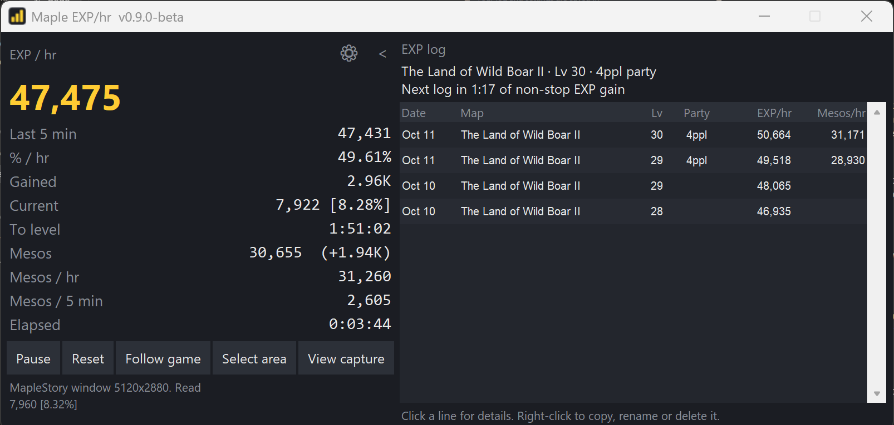
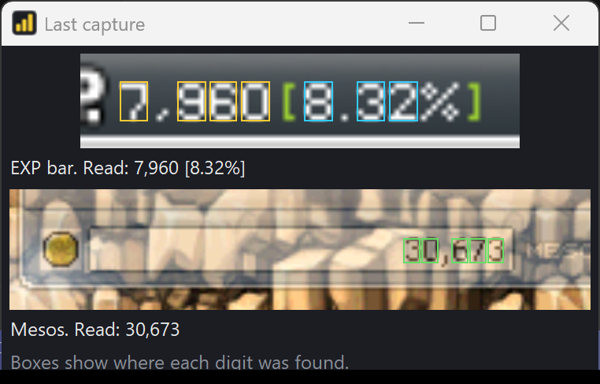

<h1> Maple EXP/hr</h1>

**A small window that sits next to MapleStory Classic World and shows how fast you're leveling and making mesos.**

> **This is a beta.** It works, but you might run into rough edges. I'm actively improving it, so check back for updates. If something doesn't work, please [tell me](../../issues)!



## What it shows

- **EXP per hour**, for your whole session and for the last 5 minutes
- **How long until your next level**
- **Mesos per hour**, read from your inventory
- **A log of every map you farm**: your EXP/hr and mesos/hr there, at which level, solo or in a party

You don't type anything in. It reads all of this from your game screen by itself.

## How to install

You need Windows 10 or 11. It takes about 2 minutes, and you don't need to install anything else.

1. Go to the **[download page](../../releases/latest)**.
2. Under **Assets**, click **MapleEXP-v0.9.0-beta.zip** (or a newer version) to download it. Don't click "Source code": that's for programmers.
3. Find the zip in your Downloads folder. **Right-click it**, choose **Extract All...**, then click **Extract**. (Just double-clicking the zip isn't enough. It has to be extracted.)
4. Open the new folder, then the **MapleEXP** folder inside it.
5. Double-click **MapleEXP.exe**. It may show as just **MapleEXP**, with a gold chart icon.

**Windows says "Windows protected your PC"?** Click **More info**, then **Run anyway**. Windows shows this for any new program that isn't from a big company.

**Keep the whole folder together.** MapleEXP.exe needs the files next to it, so don't drag it out of its folder. To put it on your desktop, right-click **MapleEXP.exe** and choose **Send to**, then **Desktop (create shortcut)**. On Windows 11, **Send to** is under **Show more options**.

## How to use it

1. **Start MapleStory.** Windowed, borderless or fullscreen all work, at any size.
2. **Open Maple EXP/hr.** It finds the game window by itself.
3. **Move the tracker so it doesn't cover these parts of the game:**
   - the minimap (top left)
   - the EXP bar (bottom)
   - the mesos at the bottom of your inventory
   - the party list

   The tracker reads them from your screen, so it can't see through itself. If it's in the way, it tells you at the bottom of its window. It remembers where you put it.
4. **Press Start** and play normally.
5. **Want mesos tracked?** Keep your inventory open, on any tab.

The numbers fill in once you've gained a little EXP. If it says "calibrating", it's just waiting for your next EXP gain.

| Button | What it does |
|---|---|
| **Start / Pause / Resume** | Starts or pauses the timer |
| **Reset** | Starts a new session from zero |
| **Follow game** | Finds the game window by itself. This is the normal mode. |
| **Select area** | Lets you drag a box around the EXP numbers, if it ever can't find them |
| **View capture** | Shows exactly what it read from your screen |
| **⚙** | Settings |
| **>** | Opens the log |

## The log

Click **>** at the top right of the tracker to open the log. It's the table on the right in the picture at the top.

- **After 5 minutes of non-stop farming**, it adds a line for that map, your level and your party size.
- **Every 5 more minutes** it updates that line, so the numbers get more accurate the longer you farm.
- **Taking a break restarts the 5-minute timer.** A break means no EXP for 15 seconds (you can change this in ⚙). Changing maps or party size restarts it too.
- **Solo** means just you. **4ppl** means a party of 4.
- **?** under Mesos/hr means your inventory wasn't open.
- **Click a line** to see how many minutes of farming it's based on.
- **Right-click a line** to:
  - **Copy line**, to paste it into Discord or anywhere else
  - **Rename map**, if it read the name wrong (it remembers the fix for next time)
  - **Delete entry**

## Settings (⚙)

- **Restart the 5-minute log clock after no EXP for...** How long a break can be before the timer starts over. The default is 15 seconds.
- **Window transparency.** Makes the tracker see-through.
- **Always on top of other windows.** Keeps the tracker above the game. It's on by default.
- **Open data folder.** Opens the folder where your log and settings are saved.

## Something not working?

**Click View capture first.** It shows exactly what the tracker read, with a box around every digit:



| Problem | Try this |
|---|---|
| An error pops up when you open MapleEXP.exe | Extract the zip first (step 3 above). It can't run from inside the zip or away from its folder. |
| "MapleStory window not found" | Start the game first. If it's minimized, bring it back up. |
| "can't find the EXP text" | Make sure nothing covers the EXP bar at the bottom of the game, including the tracker. If the game window is very small, make it bigger. |
| View capture shows the wrong part of the screen | Click **Follow game**. |
| Mesos says "open inventory" | Open your inventory. If it still doesn't show, stand still for a moment so the inventory stops being see-through. |
| The log says "Map not read yet" | Make sure the minimap is open at the top left of the game, and the tracker isn't covering it. |
| The map name is wrong | Right-click the log line and choose **Rename map**. |
| "This window is covering..." | Drag the tracker to another spot. |
| Numbers stopped updating, or anything else | Please [report it](../../issues). |

**When you report a problem,** please include:
1. A screenshot of **View capture**.
2. The file **errors.log**, if there is one. Open ⚙, click **Open data folder**, and it's in there.

## Is it safe? Is it allowed?

- **It only looks at your screen, like a screen recorder.** It never touches the game's files or memory, never presses keys or clicks for you, and never sends anything over the internet.
- **Your antivirus might warn about it.** Antivirus programs sometimes flag small new programs by mistake. All of the code is public right here, so anyone can check what it does.
- **It isn't made by or affiliated with Nexon.** Like any third-party tool, you use it at your own risk.

## Updates

This is a beta, and I'm still adding features and fixing things.

**To update:** download the newest zip from the [download page](../../releases/latest) and use it instead of the old folder. Your log and settings stay, because they're saved separately (⚙ → **Open data folder** shows where).

**To remove it:** delete its folder. To also delete your log and settings, delete the folder that **Open data folder** opens.

See [CHANGELOG.md](CHANGELOG.md) for what changed in each version.

---

<details>
<summary><b>For developers</b></summary>

**Run from source.** You need Python 3.10 or newer, and [Tesseract OCR](https://github.com/UB-Mannheim/tesseract/wiki) for map names.

```
py -3 -m pip install -r requirements.txt
run.bat
```

**Build the download** (puts `MapleEXP-v<version>.zip` in `release/`):

```
py -3 -m pip install -r requirements.txt pyinstaller
py -3 build.py
```

**Run the tests:**

```
py -3 tests/test_logic.py
```

**How it reads the screen:**
- It finds the `MapleStory.exe` window, then the EXP numbers (like `12,345 [12.34%]`) in the status bar.
- Each digit is resized to a standard size and compared against saved examples of the game's font in `assets/`.
- A reading only counts if the EXP and % agree with how much EXP that level needs, so misreads are ignored.
- Mesos are read the same way. The mesos box is found by its outline, which also works while the inventory is see-through.
- The party size is the number of HP bars in the party list.
- Map names are read with Tesseract.
- Settings, the log and `errors.log` are saved in `%APPDATA%\MapleEXP`.

</details>

## Credits

- The Classic World EXP table is from [meowdb](https://meowdb.com/msclassic/guides/exp-table-level-1-to-100). It's used to work out your level.
- Map names are read with [Tesseract OCR](https://github.com/tesseract-ocr/tesseract) (Apache 2.0 license), which is included in the download.

## License

[MIT](LICENSE): free to use, change and share.
